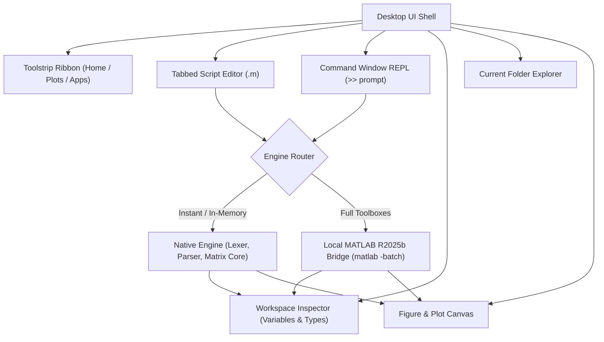

<p align="center">
  
</p>

<h1 align="center">OpenMat</h1>

<p align="center">
  <strong>Modern, Open-Source MATLAB-Compatible Scientific Computing Environment & Desktop IDE</strong>
</p>

<p align="center">
  <a href="https://opensource.org/licenses/MIT"></a>
  <a href="https://www.typescriptlang.org/"></a>
  <a href="https://react.dev/"></a>
  <a href="https://vitest.dev/"></a>
</p>

---

## 🌟 Overview

**OpenMat** is an open-source numerical computing environment and IDE designed to be compatible with MATLAB syntax, scripts, and workflows. Built with a clean-room architecture, OpenMat replicates the signature **MATLAB R2025b Desktop UI** while providing both an in-memory native computation engine and a bridge to local host installations.

### Key Highlights
- 🎨 **Replicated MATLAB R2025b UI**: Authentic Toolstrip ribbon (HOME, PLOTS, APPS, EDITOR), interactive Command Window REPL with `>>` prompt, Workspace variable inspector, Current Folder explorer, and dockable Figure window.
- ⚡ **Zero-Dependency Native Engine**: Full MATLAB syntax support with 1-based indexing, slicing (`A(1:2, :)`), element-wise operators (`.*`, `./`, `.^`), colon ranges (`1:2:10`), matrix multiplication, determinant, inversion, statistics, and control flow (`for`, `while`, `if/else`).
- 📈 **Integrated Plotting Subsystem**: Interactive 2D line plots (`plot`), scatter charts (`scatter`), bar charts (`bar`), and histograms (`histogram`) with gridlines, titles, and legends.
- 🔌 **Host MATLAB R2025b Bridge**: Seamlessly execute code through your locally installed MATLAB CLI (`matlab -batch`) when specialized proprietary toolboxes or Simulink models are required.
- 🛡️ **Clean-Room & MIT Licensed**: Written 100% from scratch with an original mathematical harmonic wave logo `[ · ]`.

---

## 🚀 Quick Start

### Installation

Clone the repository and install dependencies:

```bash
git clone https://github.com/dgonzalezgonzalez/OpenMat.git
cd OpenMat
npm install
```

### Launch Development Server

```bash
npm run dev
```

Open your browser to `http://localhost:3000` to launch the OpenMat Desktop IDE!

### Run Automated Tests

OpenMat features a comprehensive Vitest test suite covering the lexer, AST parser, matrix algebra, interpreter, and engine bridge:

```bash
npm test
```

### Build for Production

```bash
npm run build
```

---

## 📐 Architecture



For full details, see the [Architecture Document](docs/ARCHITECTURE.md) and [Reverse Engineering Analysis](docs/REA_ANALYSIS.md).

---

## 🧮 Interactive Demo in OpenMat

OpenMat includes a built-in interactive demo script (`demo.m`):

```matlab
% 1. Create a 3x3 symmetric matrix
A = [4, 1, 2; 1, 5, 3; 2, 3, 6];
disp('Matrix A:');
disp(A);

% 2. Compute Determinant & Inverse
detA = det(A);
invA = inv(A);
I = A * invA;
disp('A * inv(A) = Identity:');
disp(I);

% 3. Harmonic Waveform & Plotting
t = linspace(0, 4*pi, 100);
y = sin(t);
plot(t, y, 'Sine Wave');
title('Harmonic Waveform in OpenMat');
xlabel('Time (s)');
ylabel('Amplitude');
grid on;
```

---

## 📊 Supported Features Matrix

| Feature Area | Native Engine | Host MATLAB Bridge |
|---|:---:|:---:|
| Matrix Literals `[1, 2; 3, 4]` | ✅ | ✅ |
| 1-Based Indexing & Slicing `A(1:2, :)` | ✅ | ✅ |
| Arithmetic & Element-wise (`*`, `.*`, `./`, `.^`) | ✅ | ✅ |
| Linear Algebra (`det`, `inv`, `trace`, `norm`) | ✅ | ✅ |
| Generators (`zeros`, `ones`, `eye`, `rand`, `linspace`) | ✅ | ✅ |
| Control Flow (`for`, `while`, `if/elseif/else`) | ✅ | ✅ |
| User Functions (`function [y] = f(x)`) | ✅ | ✅ |
| Plotting (`plot`, `scatter`, `bar`, `histogram`) | ✅ | ✅ |
| Workspace Variable Inspection | ✅ | ✅ |
| Specialized Toolboxes & Simulink | Via Bridge | ✅ |

---

## 📜 Legal & Clean-Room Notice

OpenMat is an independent, clean-room open-source project. MATLAB and Simulink are registered trademarks of The MathWorks, Inc. OpenMat is not affiliated with, endorsed by, or sponsored by The MathWorks, Inc. All source code in this repository is original and licensed under the MIT License.

---

## 📄 License

This project is licensed under the [MIT License](LICENSE).
