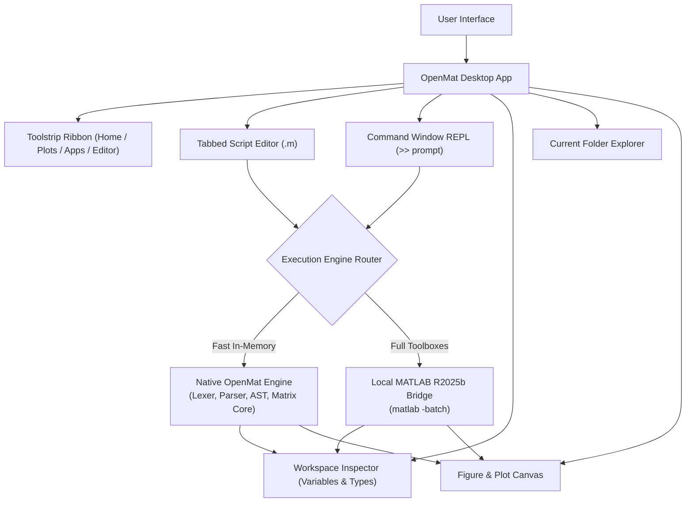

# OpenMat: Architecture & Clean-Room Design Specification

## Overview

**OpenMat** is a modern, open-source scientific computing environment and IDE designed to be compatible with MATLAB scripts, functions, and mathematical syntax. It provides:
1. An authentic replication of the **MATLAB R2025b Desktop UI** (Toolstrip ribbon, Command Window REPL, Workspace variable inspector, Current Folder explorer, Tabbed Script Editor, and Plot Figure canvas).
2. A fast, zero-dependency **Native Engine** written in TypeScript that executes core MATLAB scripts, matrix arithmetic, linear algebra, control flow, functions, and 2D/3D plotting.
3. A **Dual-Engine Bridge Architecture** allowing seamless execution routing to the host's installed MATLAB R2025b CLI (`matlab -batch`) or GNU Octave when extended specialized toolboxes are needed.



---

## 1. Clean-Room Reverse Engineering & Legal Principles

MathWorks MATLAB is proprietary software protected under copyright and trademark law. OpenMat adheres strictly to clean-room engineering:
- **No Proprietary Binary Redistribution**: None of MathWorks' Mach-O binaries, shared libraries, or compiled JavaScript assets are copied or distributed.
- **Independent Language Engine**: The lexer, recursive descent parser, multidimensional matrix subsystem, and interpreter are written completely from scratch.
- **Open Standards**: Built using standard TypeScript, React, and Tailwind CSS.
- **Original Branding**: Features an original open-bracket harmonic wave logo `[ · ]` that does not infringe on MathWorks' L-shaped membrane trademark.

---

## 2. Engine Pipeline

### 2.1 Lexical Analysis (`src/engine/lexer.ts`)
The lexer handles unique lexical rules of MATLAB:
- **Transpose vs String Quotes**: Automatically distinguishes the transpose operator `'` (when following numbers, identifiers, or closing delimiters) from the start of string literals `'...'`.
- **Matrix Delimiters**: Treats spaces inside bracketed matrix literals `[1 2 3]` as element separators equivalent to `,`.
- **Element-wise Operators**: Multi-character tokens (`.*`, `./`, `.^`, `.\`, `.'`).
- **Comments**: Single-line `%` and multi-line `%{ ... %}` block comments.

### 2.2 AST Parsing (`src/engine/parser.ts`)
The recursive descent parser builds a structured AST respecting MATLAB precedence:
- Logical OR (`||`, `|`)
- Logical AND (`&&`, `&`)
- Equality & Relational (`==`, `~=`, `<`, `<=`, `>`, `>=`)
- Colon Ranges (`start:step:end` or `start:end`)
- Arithmetic (`+`, `-`, `*`, `/`, `\`, `.*`, `./`, `.\`, `^`, `.^`)
- Unary prefix (`+`, `-`, `~`) and postfix (`'`, `.'`)
- 1-Based Indexing and Slicing (`A(1:2, :)`, `A(end)`)
- Control Flow (`if/elseif/else`, `for`, `while`)
- Function Definitions (`function [out] = name(in)`)
- Command-style invocations (`clear all`, `clc`, `grid on`, `help plot`)

### 2.3 Numerical Matrix Core (`src/engine/matrix.ts`)
- **1-Based Indexing**: Full MATLAB convention where array indices start at 1.
- **Linear Algebra**:
  - Determinant calculation via Gaussian elimination with partial pivoting (`det`).
  - Matrix inversion via Gauss-Jordan elimination (`inv`).
  - Matrix multiplication (`mul`).
  - Element-wise operations (`dotMul`, `dotDiv`, `dotPow`).
  - Reductions (`sum`, `mean`, `min`, `max`, `norm`, `trace`).
  - Output formatting matching authentic MATLAB console tables.

---

## 3. Host MATLAB Bridge (`src/engine/bridge.ts`)

When running in an environment with a local MATLAB installation (such as macOS `/Applications/MATLAB_R2025b.app`), OpenMat provides an optional bridge:
- Detects the local executable at `/Applications/MATLAB_R2025b.app/bin/matlab`.
- Executes commands in headless batch mode:
  ```bash
  /Applications/MATLAB_R2025b.app/bin/matlab -batch "<command>; exit;"
  ```
- Returns standard output, error streams, and exit codes directly into the OpenMat Command Window and Workspace.

---

## 4. Desktop UI Replication

Modeled after design tokens extracted during REA inspection of MATLAB R2025b:
- **Toolstrip Ribbon**: HOME, PLOTS, APPS, and EDITOR tabs with organized sections (FILE, VARIABLE, CODE, ENVIRONMENT, RESOURCES).
- **Command Window**: Interactive REPL with `>>` prompt, up/down command history, and clear screen (`clc`).
- **Workspace Inspector**: Real-time table of active variables, displaying Name, Value, Size, Bytes, and Class (`double`, `char`, `logical`).
- **Current Folder**: File browser with directory path bar, file search, and `.m` script association.
- **Script Editor**: Tabbed code editor with line numbers, syntax highlighting, and one-click script execution.
- **Figure Window**: Integrated canvas for 2D line plots, scatter plots, bar charts, and histograms.
